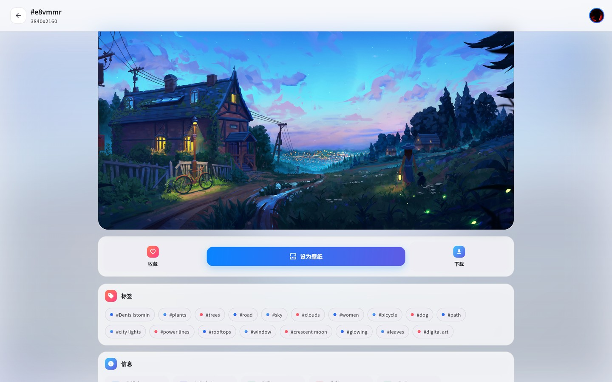
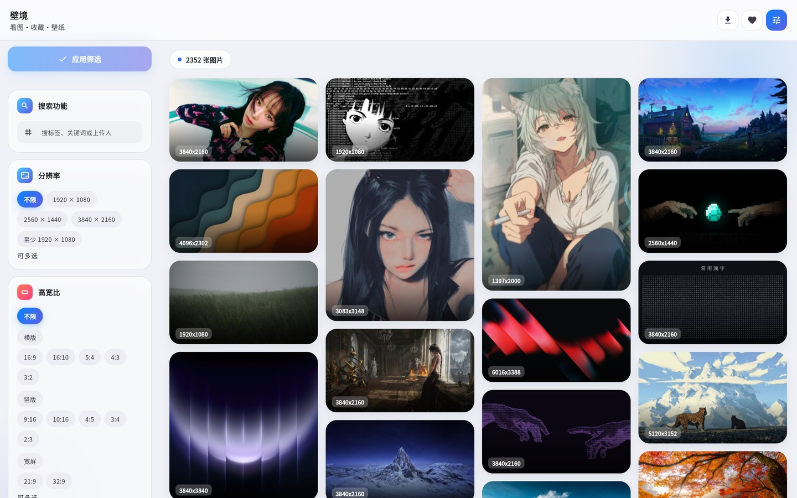
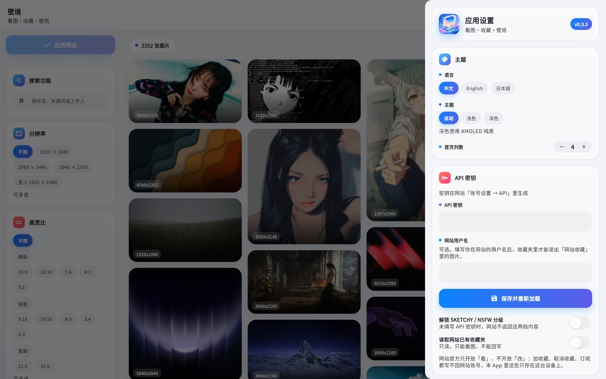
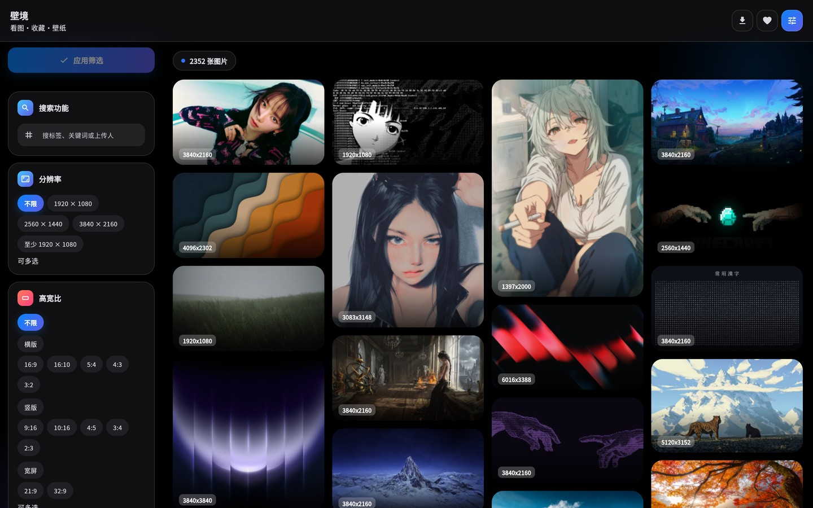

<h1>壁境 · Wallscape</h1>

<b>看图 · 收藏 · 壁纸</b> 
Browse · Collect · Wallpaper — a native Wallhaven client that also sets your desktop wallpaper.

  
  
  
  
  

<a href="#中文">中文</a> · <a href="#english">English</a>

---

## 中文

### 这是什么

壁境（Wallscape）是一个 Wallhaven 壁纸客户端：瀑布流浏览、按关键词 / 分辨率 / 高宽比 / 分级 / 排序筛选、查看大图与标签、收藏、下载，并支持一键设为系统壁纸。

一套 Flutter 代码覆盖 Windows / macOS / Linux / Android / iOS / iPadOS。界面全中文 / 英文 / 日文三语，主题支持自动、浅色与 AMOLED 纯黑深色。

除浏览壁纸之外，它更像个工具：**没有账号体系、没有埋点**，收藏与下载记录只存在这台设备上。

### 截图

| 首页（浅色） Home (light) | 设置与 API 密钥 Settings |
| :---: | :---: |
|  |  |
| **深色 AMOLED** Dark theme | **英文界面** English UI |
|  |  |

### 功能

**浏览**

- 瀑布流布局：电脑 1–8 列、手机竖屏 1–2 列，列数在「应用设置 → 首页列数」调整。
- 左侧筛选：关键词、分辨率（多选）、高宽比（横版 / 竖版 / 宽屏分组，共 12 个官方值）、分类、分级（SFW / SKETCHY / NSFW）、排序方式与方向、榜段时间。
- 卡片悬停显示收藏 / 下载按钮与下载状态角标，图片不裁剪（用原比例缩略图）。

**详情页**

- 渐进式加载：点开瞬间先用已缓存的原比例小图铺满（含整页模糊底色），高清原图到位后淡入覆盖。
- 左右滑动 / 箭头翻页（PC 悬停显示箭头），原地切换不重建路由；严格按来源列表顺序走、不跨列表；详情结果与下一张原图都会预取。
- 收藏、下载、设为壁纸三个动作；`#图片ID` 可点击复制纯 ID；点标签看同标签的图，点上传人头像看 TA 的图。
- 信息区：分辨率、文件大小、浏览数、主色、分级、上传时间、标签。

**收藏与下载**

- **本机收藏**：点一下就存在这台设备上，可随时取消，也可在设置里一键清空。
- **网站收藏**：填 API 密钥 + 网站用户名后只读展示（官方接口不开放写）。
- 已下载面板：显示图片、分辨率与「文件已丢失」标记。
- 下载路径：桌面默认 `图片库 / Wallscape`，支持自定义路径与系统文件夹选择器；移动端保存并同步到系统图库。

**外观与语言**

- 中文 / English / 日本語 全局切换。
- 主题：自动 / 浅色 / 深色，深色为 AMOLED 纯黑。
- 桌面端窗口Windows / Linux / macOS 原生层实现。

**网络**

- 支持跟随系统代理、直连、自定义代理（`主机:端口`）

### 平台支持

| 平台 | 浏览 | 下载 | 设为壁纸 | 说明 |
| --- | :---: | :---: | :---: | --- |
| Windows | ✅ | ✅ | ✅ | 单实例、最小窗口 720×520 |
| macOS | ✅ | ✅ | ✅ | 需 Mac + Xcode 构建，未在真机验证 |
| Linux | ✅ | ✅ | ✅ | 附 `wallscape-x11.sh` 作为 Wayland 会话的 X11 兜底 |
| Android | ✅ | ✅ | ✅ | 保存到 `Pictures/Wallscape`，Android 10+ 免权限 |
| iOS / iPadOS | ✅ | ✅ | ⚠️ | 系统不允许第三方直接改壁纸，改为保存相册 + 引导手动设置 |
| HarmonyOS | — | — | — | 需自行适配 |

### 翻译本地化

界面所有文字都来自 `assets/l10n/{zh-CN,en-US,ja-JP}.json`。

如想提供翻译，请复制一份出来翻译，提交issues给我，我会在校验一致后合并。

### 数据与隐私

- 收藏、下载记录、设置全部存在本机（`shared_preferences`），卸载即消失。
- API 密钥仅保存在本机，只用于向 Wallhaven 官方接口发请求，不经过任何第三方服务器。
- 不采集分析数据、不上传图片、不需要注册账号。

### 已知限制

- iOS / iPadOS 不能直接改壁纸，只能保存到相册后手动设置。
- 网站收藏只读，取消收藏只能操作本机收藏。
- macOS 与 Linux 的构建脚本已就绪，但只在作者环境验证过，欢迎反馈。

### 免责声明

本项目是非官方的第三方客户端，与 Wallhaven 无隶属关系。所有壁纸版权归原作者所有，请遵守 [Wallhaven](https://wallhaven.cc) 的服务条款与各作者授权；使用 API 密钥时请遵守官方限速要求。

### 许可证

代码以 MIT 许可证发布，你可以尽情使用和分发；
第三方资源：`assets/fonts/NotoSansSC-Subset.otf` 是 Noto Sans SC 的子集，采用 SIL 开放字体许可协议 1.1（SIL Open Font License 1.1，见 `assets/fonts/OFL.txt`）授权。
应用图标与截图中的壁纸版权归各自作者所有。

---

## English

### What is this

**Wallscape** is a Wallhaven client for desktop and mobile: browse the waterfall grid, filter by keyword / resolution / aspect ratio / purity / sorting, open a wallpaper with its tags and metadata, collect it, download it — and set it as your system wallpaper in one click.

One Flutter codebase targets Windows, macOS, Linux, Android and iOS/iPadOS. The interface ships in Chinese, English and Japanese, with auto / light / AMOLED-black themes.

Beyond browsing, it is built like a personal tool: **no accounts, no telemetry** — favourites and download records stay on the device.

### Platform support

| Platform | Browse | Download | Set wallpaper | Notes |
| --- | :---: | :---: | :---: | --- |
| Windows | ✅ | ✅ | ✅ | Single instance, 720×520 minimum window |
| macOS | ✅ | ✅ | ✅ | Needs Mac + Xcode, not verified on real hardware |
| Linux | ✅ | ✅ | ✅ | Ships `wallscape-x11.sh` as an X11 fallback under Wayland |
| Android | ✅ | ✅ | ✅ | Saves to `Pictures/Wallscape`, no permission needed on Android 10+ |
| iOS / iPadOS | ✅ | ✅ | ⚠️ | Third-party apps cannot change the wallpaper; saves to Photos and guides the user |
| HarmonyOS | — | — | — | Needs a separate port |

### Features

- **Browse** — waterfall grid (1–8 columns on desktop, 1–2 on phones), filters for keyword, resolution, 12 official aspect ratios grouped as landscape / portrait / wide, category, purity, sort method, direction and toplist range.
- **Detail page** — progressive loading (cached small image first, HD fades in), prev/next by swipe or hover arrows following the exact order of the list you came from, copyable wallpaper ID, clickable tags and uploader, info card.
- **Collections** — favourites stored on device, plus read-only access to your site collections via API key (the official API has no write endpoints).
- **Downloads** — default folder `Pictures/Wallscape`, customisable on desktop with a native folder picker; on mobile images go to the system gallery.
- **Wallpaper** — native "set as wallpaper" on Windows, macOS, Linux and Android.
- **Look & feel** — Chinese / English / Japanese, auto / light / dark (AMOLED pure black).
- **Network** — system proxy, direct, or custom `host:port` proxy covering both API calls and images (desktop only).

### Screenshots

The grid in the [中文 section](#截图) shows the light home page, the settings drawer, the AMOLED dark theme and the English UI; a detail page is shown at the top of this file.

### Localization

All UI strings live in `assets/l10n/{zh-CN,en-US,ja-JP}.json`. 
To add a language, Please create a copy for translation and submit it to me via an issue; I will merge it once I have verified that it matches the original.:

### Privacy

Preferences, favourites, download history and the API key are stored locally with `shared_preferences`. The key is only sent to `wallhaven.cc`; images come from Wallhaven's CDNs. No analytics, no uploads, no sign-up.

### Known limitations

- iOS / iPadOS cannot change the wallpaper; images are saved to Photos for manual setup.
- The web build is a preview only — download and set-wallpaper show an explanatory hint.
- Site collections are read-only; unfavouriting only affects local favourites.

### Disclaimer

Unofficial third-party client, not affiliated with Wallhaven. All wallpapers belong to their respective authors; please respect Wallhaven's terms of service and rate limits.

---

## License

MIT License — You are free to use and distribute it..

Third-party assets: `assets/fonts/NotoSansSC-Subset.otf` is a subset of Noto Sans SC licensed under the SIL Open Font License 1.1 (`assets/fonts/OFL.txt`). App icons and the wallpapers shown in screenshots remain the property of their authors.
